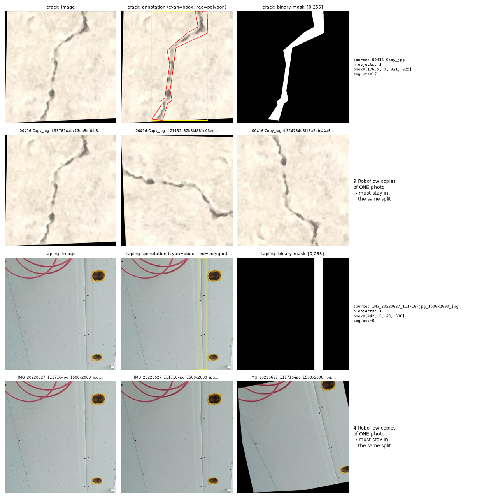
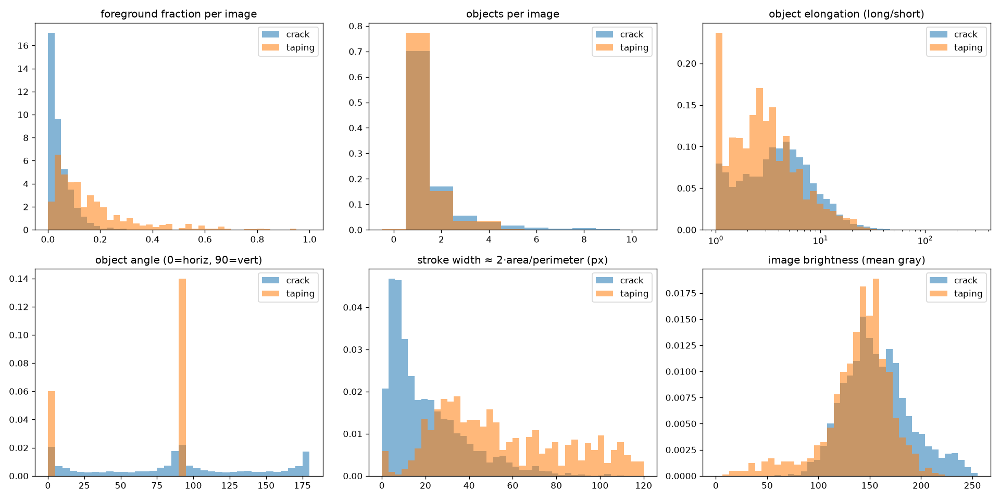
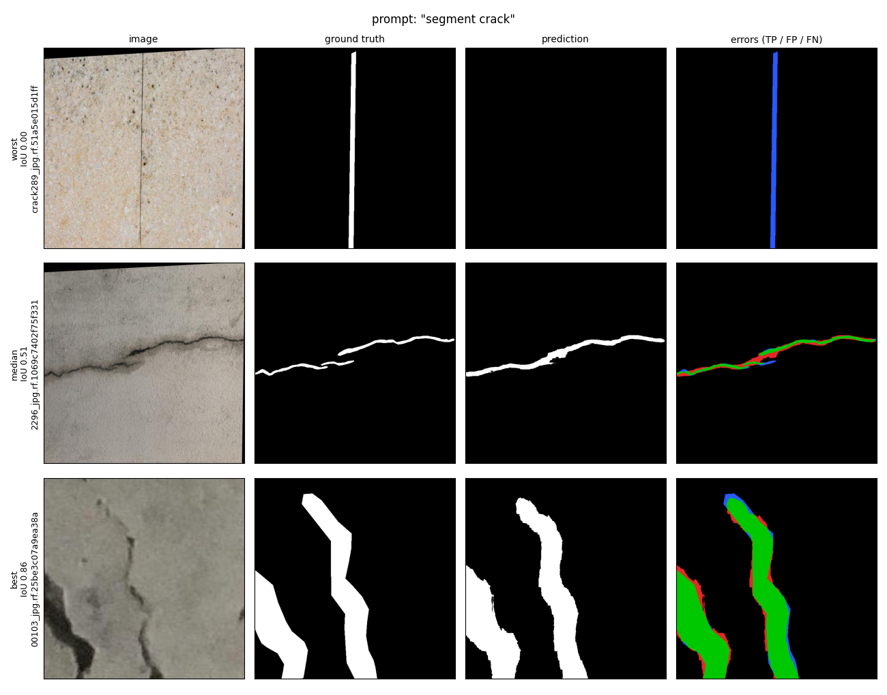
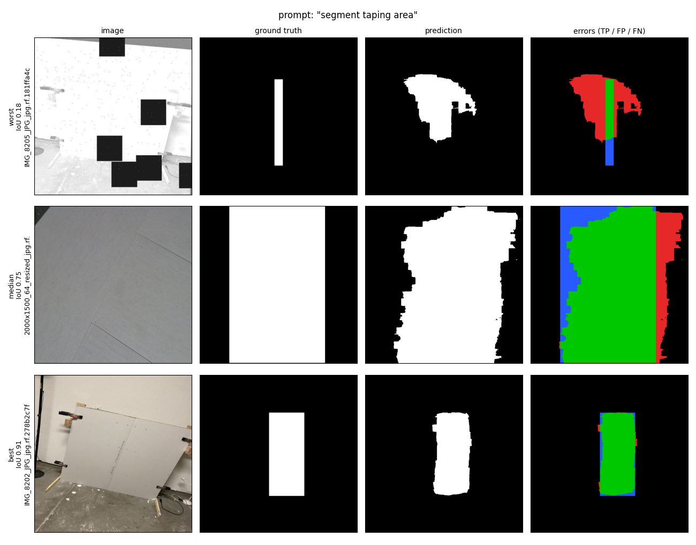

# Report: Prompted Segmentation for Drywall QA

## 1. Goal

Build one model that takes **an image + a text prompt** and returns a **binary mask**:

- `"segment crack"` → mask of the cracks (Dataset 2: Cracks)
- `"segment taping area"` → mask of the drywall joints / tape (Dataset 1: Drywall-Join-Detect)

The same model must handle both prompts. The prompt decides what gets segmented.

**Final result on the test set (fine-tuned CLIPSeg):**

| | IoU | Dice |
|---|---|---|
| segment crack | 0.492 | 0.638 |
| segment taping area | 0.732 | 0.838 |
| **mean (mIoU / mDice)** | **0.612** | **0.738** |

This is 2.5× better than the same model without fine-tuning (mIoU 0.244).

---

## 2. The data

### What I found when I looked at the data

| | Cracks | Drywall-Join (taping) |
|---|---|---|
| Images | 5369 | 1022 |
| **Unique original photos** | **1110** | **164** |
| Label type | polygons (shape of the crack) | **boxes only** (no shape) |
| Average size of the object | ~3% of the image | ~12% of the image |

Things that changed my plan:

1. **Most images are augmented copies.** Roboflow names every copy `<original>.rf.<hash>.jpg`.
   On average one crack photo has ~5 copies and one taping photo has ~6 copies (rotated, flipped,
   grayscale, black squares pasted on, etc.).
2. **Roboflow's own split leaks.** 82 of the 164 taping photos have copies in both train and valid.
   A model would be tested on photos it already saw in training, and the score would look better than it is.
   Also, the crack test set had only 4 images and the taping dataset had no test set.
3. **Taping labels are boxes only.** So my taping "masks" are filled rectangles. This works because tape
   strips are long, straight rectangles anyway, but the model is graded against rectangles.
4. **Cracks are thin and small.** A crack covers only ~3% of the image. A model that predicts "no crack"
   everywhere would still be 97% correct per pixel. This decided my loss function (section 3).
5. **Crack labels are not consistent.** Some cracks are traced pixel-thin, others with a thick rough polygon.


*Top: a crack polygon and its mask, plus copies of the same photo. Bottom: a taping box and its mask.*



### My split (augmentation-aware)

I split by **original photo**, not by image: all copies of one photo go to the same split.
70 / 15 / 15, seed 42, done separately per dataset (`prepare_data.py`).

| | train | val | test | total | unique photos |
|---|---|---|---|---|---|
| crack | 3759 | 805 | 805 | 5369 | 1110 |
| taping | 718 | 147 | 157 | 1022 | 164 |

I also dropped 19 broken taping boxes (less than 2 px wide).

---

## 3. Approach

### Model choice: CLIPSeg

I chose **CLIPSeg** (`CIDAS/clipseg-rd64-refined`) because:

- It is made exactly for this task: image + text → mask.
- It is built on CLIP, which already knows what words like "crack" or "tape" look like
  (trained on 400M image–text pairs). So I don't start from zero.
- It is small enough (150M parameters) to train on a free Colab GPU.

How it works in one line: CLIP reads the image and the prompt, and a small decoder uses the prompt to
decide which pixels to light up.

### What I trained and why

| Decision | Why I did it |
|---|---|
| **Froze the CLIP encoders, trained only the decoder** (1.13M of 150.7M parameters) | Only 164 unique taping photos, so training all 150M weights would overfit. Freezing CLIP also keeps its language knowledge, so other wordings ("drywall seam", "wall crack") still work. It also fits the free T4 GPU. |
| **Several wordings per class** ("segment crack", "wall crack", "segment drywall seam", "joint tape", ...). The main prompt is used 50% of the time. | So the model learns the meaning, not one exact sentence. |
| **Negative pairs** (20% of samples): a crack image with the prompt "segment taping area" → empty mask, and the other way round | Cracks and seams are both dark lines on a wall. Without this, the model could ignore the text and mark every line. This makes it actually read the prompt. |
| **Balanced sampling** (50% crack, 50% taping in every batch) | Crack has 5× more images than taping. |
| **Loss = BCE + Dice** | BCE gives stable per-pixel learning. Dice looks at the overlap of the object, so the huge background can't hide a missed crack. |
| **Augmentation**: flips, 90° rotation, crop, brightness/contrast, colour, blur, noise | More variety from a small dataset. |
| **Separate threshold per class, tuned on val** (crack 0.40, taping 0.45) | Turning probabilities into a 0/255 mask needs a cut-off. I chose it on val and never on test. |
| Metrics computed at the **original 640 px**, not at the model's 352 px | This is the size of the masks I submit. |

### Training setup

AdamW, learning rate 1e-3, cosine schedule with 1 warm-up epoch, batch 16, mixed precision (fp16),
up to 40 epochs with early stopping (patience 5), **seed 42**.
Everything is in one config file: [configs/clipseg_ft.yaml](configs/clipseg_ft.yaml).

Validation mIoU during training:

| epoch | 0 (no training) | 1 | 5 | 10 | 15 | 20 | **23 (best)** | 28 (stopped) |
|---|---|---|---|---|---|---|---|---|
| val mIoU | 0.194 | 0.458 | 0.524 | 0.563 | 0.567 | 0.574 | **0.593** | 0.583 |

I trained this config twice. The best val mIoU was **0.591** and **0.593**, so the result is stable between runs.

---

## 4. Results (test set)

### Main table

| | Zero-shot CLIPSeg (no training) | **Fine-tuned CLIPSeg (mine)** |
|---|---|---|
| crack IoU / Dice | 0.313 / 0.439 | **0.492 / 0.638** |
| taping IoU / Dice | 0.175 / 0.256 | **0.732 / 0.838** |
| **mIoU / mDice** | 0.244 / 0.347 | **0.612 / 0.738** |
| "leak": mask area when the prompt asks for the *other* class (lower is better) | 0.15 / 0.30 | **0.000 / 0.001** |

The leak row matters: when I ask a crack image to "segment taping area", the fine-tuned model returns an empty mask.
So it really follows the prompt. This came from the negative pairs.

### Consistency across different scenes

I split the test images into 3 equal groups (low / mid / high) by brightness, contrast and sharpness,
and checked IoU in each group.

| class | factor | low | mid | high | spread |
|---|---|---|---|---|---|
| crack | brightness | 0.484 | 0.503 | 0.491 | 0.020 |
| crack | contrast | 0.499 | 0.496 | 0.482 | 0.017 |
| crack | sharpness | 0.474 | 0.472 | 0.526 | 0.053 |
| taping | brightness | 0.737 | 0.767 | 0.688 | 0.079 |
| taping | contrast | 0.717 | 0.773 | 0.707 | 0.066 |
| taping | sharpness | 0.732 | 0.724 | 0.739 | 0.015 |

The biggest difference between groups is 0.08 IoU (zero-shot was up to 0.15), so the model behaves
about the same in dark/bright, low/high contrast and blurry/sharp images.

### Visual examples (image | ground truth | prediction | errors)

In the error column: green = correct, red = extra pixels, blue = missed pixels.
Rows are the worst, median and best test image.





### Runtime and footprint

| | |
|---|---|
| GPU | Tesla T4 (free Colab), 15 GB |
| Training time | **70.4 min** (28 epochs, early stopped, best at epoch 23) |
| Inference time | **23.3 ± 3.9 ms per image** (resize → model → upsample → threshold, fp16, T4) |
| Model size | 150.7M parameters, **575 MB** in fp32 (pretrained CLIPSeg + my decoder) |
| My trained weights | 1.13M parameters, **4.3 MB** checkpoint |

---

## 5. Root-cause analysis: where the model loses points

After the first good result I wanted to know *why* crack (0.49) is so much lower than taping (0.73).
I wrote `analyze_errors.py`, which splits the test errors by crack width, size and error type.

### Finding 1: thin cracks are the main problem

| crack width | images | IoU | predicted area ÷ true area |
|---|---|---|---|
| < 5 px | 68 | **0.23** | 3.5× (far too thick) |
| 5–10 px | 150 | 0.44 | 1.6× (too thick) |
| 10–20 px | 210 | 0.53 | 1.0× (right) |
| 20–40 px | 269 | 0.53 | 0.8× (too thin) |
| > 40 px | 108 | 0.57 | 0.7× (too thin) |

The model draws every crack at about the same width (~15 px). Thin cracks come out too fat and wide cracks
too thin.

**Why:** CLIPSeg looks at the image as a **22×22 grid** of patches (352 px / 16 px). One patch covers about
29×29 pixels of the original image, so a 3 px crack is a small part of one patch. I checked this by shrinking the
true masks to 22×22 and back: cracks thinner than 10 px disappear completely (best possible IoU ≈ 0), and
the average crack ceiling is about 0.44, which is close to the real crack score. **The limit here is resolution, not
training.**

### Finding 2: the worst images are label problems

The 12 worst crack images are copies of only **2 photos**:

- In one, the "crack" is a perfectly straight line that looks like a joint between two stone panels.
  My model was trained to treat straight lines as seams, so it does not call it a crack.
- In the other, I could not see any crack at the labelled place.

The model predicts an empty mask on these, and on only 7 of 805 crack test images in total
(0 of 157 for taping). I count these as label noise, not model errors.

### Finding 3: taping errors are small outline errors

93% of taping errors are "shape" errors: the area is right but the outline differs a bit. That is expected
when the ground truth is a rectangle. The worst taping image is a heavily augmented copy (grayscale,
with black squares pasted on), where the model marks a big blob.

---

## 6. Experiments that did not work (and why I tried them)

| Experiment | Why I tried it | What happened | What I learned |
|---|---|---|---|
| **Zero-shot CLIPSeg** (no training) | Baseline: how much does fine-tuning add? | mIoU 0.244. Taping was very poor (0.175) and it "leaked": it marked things even when asked for the wrong class. | CLIP knows "crack", but not what a "taping area" on drywall looks like. Fine-tuning is needed. |
| **Lower learning rate (1e-4 instead of 1e-3)** | The decoder is already pretrained, so I worried that big steps (1e-3) would damage it. | Trained slower and ended worse than 1e-3. | The decoder is small and needs bigger steps to adapt. I kept 1e-3. |
| **Bigger input: 640 px instead of 352 px** (40×40 grid) | The root-cause analysis said thin cracks are lost on the 22×22 grid. A bigger input gives a finer grid. | The model learned slower than the 352 px one, and every epoch is much heavier (3.3× more image patches: 1600 vs 484). With free Colab GPU time I could not train it long enough to beat the 352 px model, so I did not use it. Config: [configs/clipseg_ft_640.yaml](configs/clipseg_ft_640.yaml). | The idea is right, but it needs more GPU time than I had. |
| **SAM 3** (Meta, newest text-prompted segmentation model) | It works at 1008 px with a high-resolution mask decoder, which fits exactly my thin-crack problem. | The model weights are gated on Hugging Face and my access request was **not approved** in time, so I could not test it. Also, it has ~850M parameters, so fine-tuning it on a free T4 would be very hard. | Planned as future work. |
| **Finding duplicate photos with image hashing** (for the split) | Some copies might have different file names. | My first version (64-bit hash) put 1067 unrelated plain-wall images into one "duplicate" group, because plain walls look alike to a small hash. | I used a 256-bit hash in the analysis notebook, and for the real split I grouped by the original file name, which is reliable for Roboflow copies. |

---

## 7. Limitations

- **Thin cracks (< 10 px)** are the weakest part (IoU 0.23–0.44), because of CLIPSeg's 22×22 grid.
- **Taping ground truth is boxes**, so the taping score measures "how well does it draw the rectangle", not the exact tape.
- **Only 164 unique taping photos.** More real photos would help more than more augmentation.
- **Label noise in cracks** (thin traces mixed with thick polygons, a few wrong labels).
- **The test set contains augmented copies** (about 5 per photo), so each hard photo counts several times.
- **GPU limits:** my laptop has a 4 GB GPU, so all training ran on a free Colab T4. That is why I froze the
  backbone, and why the 640 px and SAM 3 experiments could not be finished.

## 8. What I would do next

1. Train the 640 px model longer (more GPU time), or try SAM 3 once access is approved. Both target thin cracks.
2. Test-time flips: average predictions over flipped images. No retraining needed.
3. Clean the crack labels (remove the straight-line and missing-crack cases) and retrain.
4. Get real polygon labels for taping instead of boxes.

---

## 9. How to reproduce

See [README.md](README.md). In short (Colab, T4):

```bash
python prepare_data.py --config configs/clipseg_ft.yaml        # masks + split, seed 42
python train.py        --config configs/clipseg_ft.yaml --set train.epochs=40
python evaluate.py     --run runs/<run-folder>                  # test metrics + example images
python analyze_errors.py --eval-dir runs/<run-folder>/eval_test # root-cause tables
python predict.py      --run runs/<run-folder> --split test     # submission masks
```

**Seed:** 42 (split, sampling, augmentation, initialisation). GPU kernels are not fully deterministic
(`deterministic: false` for speed). Two runs gave best val mIoU 0.591 and 0.593.

All numbers in this report are from [results/](results/): `finetuned_test_results.md`,
`finetuned_test_rca.md`, `zeroshot_test_results.md`, `train_info.json`, `history.jsonl`.
